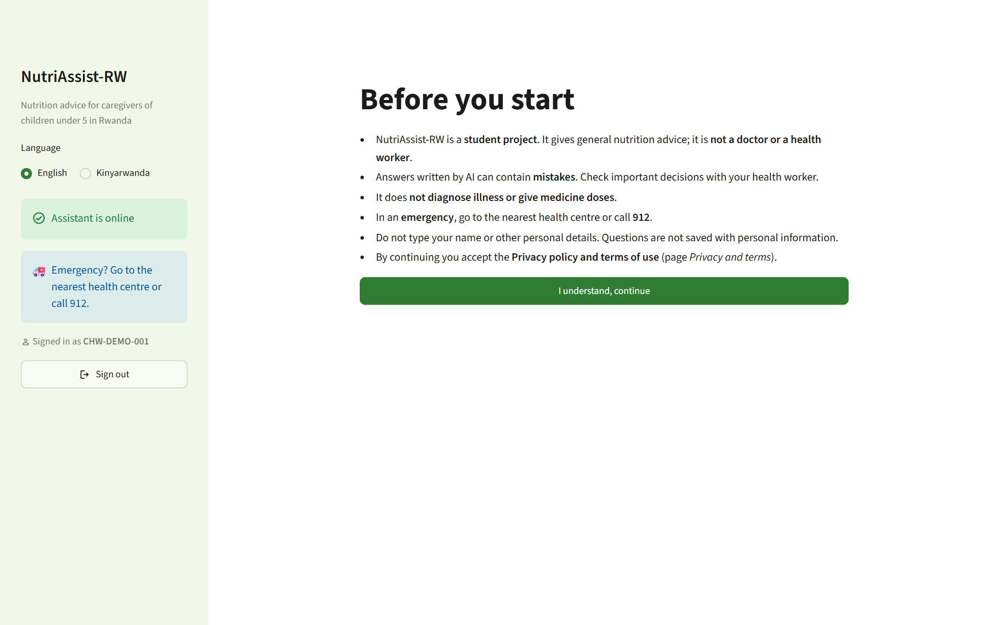
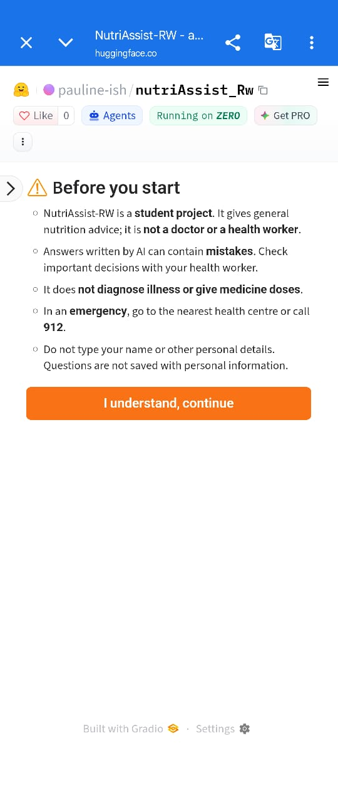

# NutriAssist-RW

**A bilingual (English / Kinyarwanda) nutrition assistant and meal planner for caregivers of children under 5 in Rwanda.**

NutriAssist-RW answers questions on breastfeeding, feeding children from 6 months to 5 years, maternal
nutrition and local foods. It sends caregivers to the health centre when a question describes a danger
sign, and builds meal plans from local Rwandan foods sized for the child's age.

| | |
|---|---|
| **Live app** | https://huggingface.co/spaces/pauline-ish/nutriAssist_Rw (the first visit after a quiet period takes a few minutes to wake up) |
| **Walkthrough video** | [Watch the demo (Google Drive)](https://drive.google.com/drive/folders/1Lt9xp5sJ1G7Hn1PMMkvfGXrB9uKC6jKV?usp=sharing) |
| **Technical report** | https://docs.google.com/document/d/1BxUJMjiChwt-fdrzl4D_yUkv_gVp7zRuUHOEspxrXbw/edit?usp=sharing |
| **Training notebook** | [Open in Colab](https://colab.research.google.com/github/pauline12ish34/NutriAssist_Capstone/blob/main/notebooks/nutriassist_training.ipynb) |
| **Repository** | https://github.com/pauline12ish34/NutriAssist_Capstone |

> NutriAssist-RW gives general nutrition guidance. It does not diagnose illness or recommend medicines.
> In an emergency, go to the nearest health centre or call **912**.

---

## Features

- **Ask a question** in English or Kinyarwanda. Answers come from a fine-tuned small language model,
  or from answers reviewed by a native Kinyarwanda speaker when the question matches one.
- **Danger-sign alerts.** Questions describing urgent signs (for example, a child who cannot drink or is
  very sleepy) get an immediate referral to the health centre.
- **Meal planner.** 1–7 day meal plans for children aged 6–59 months from local foods, with portions in
  tablespoons.
- **Growth check.** Community health workers (abajyanama b'ubuzima) enter the weight, MUAC and height they
  already measure; the app computes WHO z-scores, classifies wasting, stunting and underweight, and either
  refers the child to the health centre today (severe) or gives feeding advice and a meal plan.
  See [growth check](docs/screening.md).
- **API** with interactive documentation (Swagger UI) for developers.

## Screenshots

| | |
|---|---|
|  |  |
| **Disclaimer** before first use (local app) | **Ask a question**: a model answer with the "Written by AI" label |
|  |  |
| **Danger-sign alert**: answered by the safety rules, without the model | **Meal planner**: a 7-day plan from local foods, portions in tablespoons |



The live app on an Android phone.

## How it works

```
Question ─► language detection ─► danger-sign rules ─┬─ urgent ─► fixed referral message
                                                     └─ other ──► reviewed answer if one matches,
                                                                  otherwise the fine-tuned model
                                                                  (Kinyarwanda through Gemini translation)
Meal plan ─► nutrient targets by age ─► local foods chosen ─► portions and tips
```

| | Online (live app) | On your computer |
|---|---|---|
| Interface | Gradio | Streamlit + FastAPI |
| Model | Gemma-3-4B, fine-tuned (GPU) | Qwen2.5-1.5B, fine-tuned (CPU) |

Design, algorithms, experiment results and testing strategies are in the technical report and in
[docs/technical_details.md](docs/technical_details.md).

## Results

The live model is Gemma-3-4B fine-tuned with QLoRA (experiment `exp9`), chosen from 10 logged runs on
Qwen2.5-1.5B and three Gemma sizes by validation chrF. On the 78 held-out test questions (English and
Kinyarwanda), compared with the same model before fine-tuning:

| Test metric | Base model | Fine-tuned | Change |
|---|---|---|---|
| ROUGE-L | 6.0 | 31.0 | +417% |
| chrF | 24.0 | 39.7 | +65% |
| BLEU | 0.5 | 14.0 | +13.5 points |
| Perplexity (lower is better) | 189.3 | 7.5 | −96% |
| Referral F1 (refers when it should) | 36.0% | 75.4% | +109% |
| Danger questions referred | 2 of 12 | 11 of 12 | |
| Answer in the question's language | 57.7% | 100% | +73% |
| Numeric accuracy (±10%) | 25.3% | 30.5% | +21% |

- **Rewording:** on reworded test questions the model never saw, scores drop by only 1.4–5.6%.
- **Kinyarwanda:** chrF rose from 19.9 to 37.7, but many fluent answers address a different question, so
  the app shows Kinyarwanda from reviewed answers ([why](docs/kinyarwanda.md)).
- **Growth check:** all 61,396 test measurements built from the WHO reference tables are classified
  correctly ([details](docs/screening.md)).
- **Tests:** 400 automated tests pass (4 November 2026).

Training curves, the full experiment table (time and peak GPU memory per run), confusion matrices and
side-by-side answers are in the [training notebook](notebooks/nutriassist_training.ipynb).

## Use the app online

Open the [live app](https://huggingface.co/spaces/pauline-ish/nutriAssist_Rw). Nothing to install.

1. Read the disclaimer and press **I understand, continue**.
2. Choose **English** or **Kinyarwanda**.
3. **Ask a question:** type a question or tap an example.
4. **Meal planner:** set the child's age, whether the child is breastfed and 1 or 7 days, then press
   **Make my plan**.
5. **How to use** explains the features and their limits.

## Run the app on your computer

**Requirements:** Python 3.10 or newer (3.12 recommended), Git, about 2 GB of free RAM and 2 GB of disk
space. Works on Windows, macOS and Linux.

**1. Get the code and install**

```bash
git clone https://github.com/pauline12ish34/NutriAssist_Capstone.git
cd NutriAssist_Capstone
python -m venv .venv
# Windows: .venv\Scripts\activate      macOS/Linux: source .venv/bin/activate
pip install --extra-index-url https://abetlen.github.io/llama-cpp-python/whl/cpu -e ".[serve,app,gemini,dev]"
```

**2. Download the trained model** (about 1 GB) into `models/`:

```bash
python -c "from huggingface_hub import hf_hub_download; hf_hub_download('pauline-ish/NutritionAssistant_RW', 'nutriassist-rw-q4_k_m.gguf', local_dir='models')"
```

Or download [nutriassist-rw-q4_k_m.gguf](https://huggingface.co/pauline-ish/NutritionAssistant_RW/resolve/main/nutriassist-rw-q4_k_m.gguf)
in the browser and move it into `models/`.

**3. (Optional) Kinyarwanda answers.** Kinyarwanda questions with no reviewed answer are translated by
Google Gemini. Get a free key at [Google AI Studio](https://aistudio.google.com/apikey) and save it in a
file named `.env` in the project folder:

```
GEMINI_API_KEY=your-key-here
```

Without a key, English works fully and Kinyarwanda questions get reviewed answers or "Did you mean...?"
suggestions.

To translate with Anthropic Claude instead (paid, from [console.anthropic.com](https://console.anthropic.com);
a Claude Pro subscription does not include API use), install `pip install -e ".[claude]"`, add
`ANTHROPIC_API_KEY=your-key-here` to `.env`, and choose Claude when you start the app (PowerShell):

```
$env:NUTRIASSIST_TRANSLATOR = "claude"
python scripts/run_local.py
```

The model is `claude-sonnet-5-5` by default (`NUTRIASSIST_CLAUDE_MODEL` changes it). On the Space, set
`ANTHROPIC_API_KEY` as a secret and `NUTRIASSIST_TRANSLATOR` as a variable. To compare the two translators
blind on reviewed answers, run `python scripts/compare_translators.py`.

**4. Start the app**

```bash
python scripts/run_local.py
```

- App: http://localhost:8501
- API documentation (Swagger UI): http://localhost:8000/docs

The first answer takes a few seconds while the model loads. Stop the app with Ctrl+C.

**With Docker (optional),** instead of steps 1–4 (after downloading the model):

```bash
docker build -t nutriassist .
docker run -p 7860:7860 -p 8000:8000 -v "${PWD}/models:/home/user/app/models" nutriassist
```

Then open http://localhost:7860.

### Troubleshooting

| Problem | Fix |
|---|---|
| "Port 8501 is not available" or *Server error 500* | An earlier copy is still running. Close it (or restart the computer) and run `python scripts/run_local.py` again. |
| Chat answers are placeholders | The model file is missing from `models/` (demo mode: safety rules and meal planner still work). |
| `llama-cpp-python` fails to install | Keep the `--extra-index-url` in step 1: it installs a prebuilt version. |
| Kinyarwanda questions only get "Did you mean...?" | No Gemini key in `.env`, or the free daily Gemini limit was reached. |

## Run the tests

```bash
pytest
```

GitHub Actions runs the tests on every push on Windows, macOS and Linux. When they pass on `main`, it
restarts the Hugging Face Space so the live app uses the latest code.

## Technical requirements

| | Version used |
|---|---|
| Python | 3.12 (3.10+ supported) |
| Local app | Streamlit 1.66, FastAPI 0.150, Uvicorn, llama-cpp-python 0.3.36 |
| Online app | Gradio 6.31 on a Hugging Face ZeroGPU Space, PyTorch 2.13, Transformers 5.x, PEFT 0.21 |
| Training | Google Colab GPU, PyTorch, Transformers, PEFT, bitsandbytes |
| Models | Gemma-3-4B-it and Qwen2.5-1.5B-Instruct with LoRA adapters ([Hugging Face Hub](https://huggingface.co/pauline-ish/NutritionAssistant_RW)) |

## Repository structure

```
├── app/              web interfaces (Gradio online, Streamlit locally)
├── src/nutriassist/  Python package: assistant, safety rules, meal planner, API, training, evaluation
├── notebooks/        Colab training notebook
├── data/             food tables and the question-answer dataset
├── tests/            automated tests
├── docs/             documentation and results
├── deploy/           Hugging Face Space files
├── scripts/          local launcher and helper scripts
└── Dockerfile        API + app in one container
```

## Deployment

The live app runs on a free Hugging Face ZeroGPU Space. Step-by-step instructions for running locally,
in Docker and on Hugging Face are in the [deployment guide](docs/deployment.md).

## More documentation

- [Technical details: design, results, testing](docs/technical_details.md)
- [Growth check: WHO z-scores, cut-offs and validation](docs/screening.md)
- [Why Kinyarwanda answers come from reviewed pairs](docs/kinyarwanda.md)
- [Performance and compatibility](docs/performance.md)
- [Data inspection](docs/data_inspection.md), [nutrient cleaning](docs/nutrient_cleaning.md) and [QA dataset](docs/qa_dataset.md)
- [Deployment guide](docs/deployment.md)

## Author

Pauline Ishimwe — BSc Software Engineering capstone, African Leadership University. Supervisor: Junior Turatsinze.
