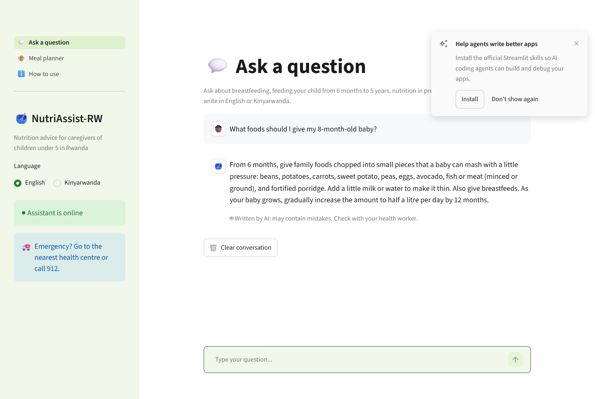
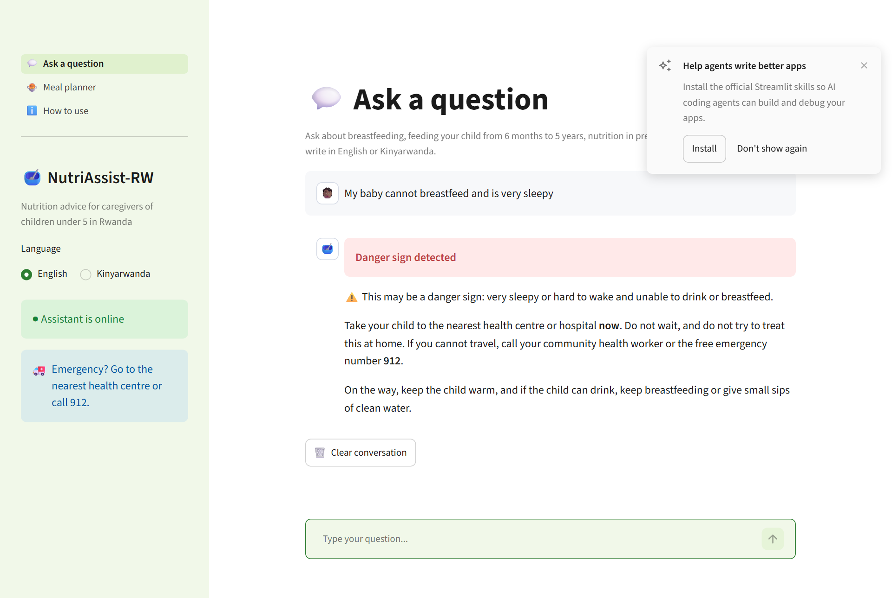
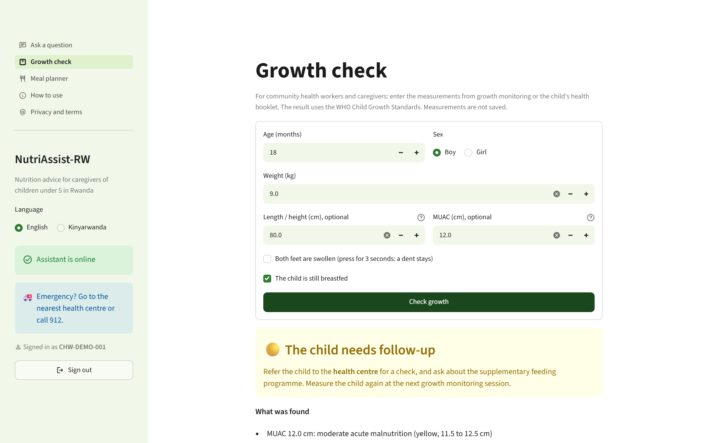
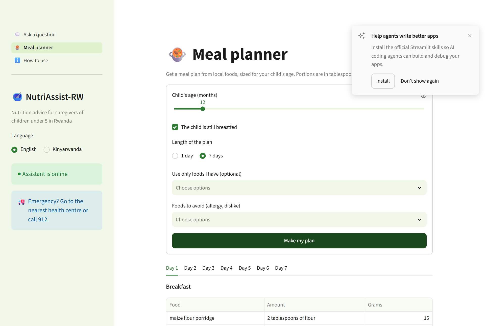

# NutriAssist-RW

[](https://github.com/pauline12ish34/NutriAssist_Capstone/actions/workflows/tests.yml)

**A bilingual (English / Kinyarwanda) nutrition assistant, growth check and meal planner for caregivers of
children under 5 in Rwanda and the community health workers who support them.**

| | |
|---|---|
| **Live app** | https://nutriassistcapstone-v1.streamlit.app |
| **Walkthrough video** | [Watch the demo (Google Drive)](https://drive.google.com/drive/folders/1Lt9xp5sJ1G7Hn1PMMkvfGXrB9uKC6jKV?usp=sharing) |
| **Technical report** | [Technical report (PDF)](https://docs.google.com/document/d/1BxUJMjiChwt-fdrzl4D_yUkv_gVp7zRuUHOEspxrXbw/export?format=pdf) · [view online](https://docs.google.com/document/d/1BxUJMjiChwt-fdrzl4D_yUkv_gVp7zRuUHOEspxrXbw/view) |
| **Training notebook** | [Open in Colab](https://colab.research.google.com/github/pauline12ish34/NutriAssist_Capstone/blob/main/notebooks/nutriassist_training.ipynb) |
| **Models** | [Hugging Face Hub](https://huggingface.co/pauline-ish/NutritionAssistant_RW) |

> NutriAssist-RW gives general nutrition guidance. It does not diagnose illness or recommend medicines.
> In an emergency, go to the nearest health centre or call **912**.

---

## Overview

In 2025, 27% of Rwandan children under five were stunted (RDHS 2025). General chatbots give inconsistent
nutrition advice and rarely know local foods. NutriAssist-RW combines a fine-tuned small language model with
answers reviewed by a native Kinyarwanda speaker, rule-based safety checks, a WHO growth check and a meal
planner built on a cleaned table of Rwandan foods. Numbers and urgent advice come from code or reviewed text,
so the language model is never the only safeguard.

## Features

| Feature | What it does |
|---|---|
| **Ask a question** | Answers on breastfeeding, feeding from 6 months to 5 years, maternal nutrition and local foods, in English or Kinyarwanda. A reviewed answer is used when the question matches one; otherwise the fine-tuned model answers (Kinyarwanda through Gemini translation, labelled as machine-translated). |
| **Danger-sign alerts** | Questions describing urgent signs (a child who cannot drink, is very sleepy, has convulsions) get an immediate referral to the health centre, without calling the model. |
| **Scope checks** | Questions about adults or children over 5 are declined without the model; questions that also mention a young child stay in scope. |
| **Growth check** | Weight, height and MUAC give WHO 2006 z-scores and a wasting, stunting and underweight classification. Severe cases are referred; others get feeding advice and a meal plan. See [docs/screening.md](docs/screening.md). |
| **Meal planner** | 1–7 day plans for children aged 6–59 months from 33 local foods, with portions in tablespoons. |
| **CHW sign-in (demo)** | Community health workers sign in with a CHW ID and a code. The IDs are made up; a real rollout would check Ministry of Health records. |
| **REST API** | FastAPI backend with interactive Swagger documentation for the local deployment. |

## Screenshots

| | |
|---|---|
|  |  |
| **Chat**: a model answer with the "Written by AI" label | **Danger-sign alert**: answered by the safety rules |
|  |  |
| **Growth check**: WHO z-scores and classification | **Meal planner**: a 7-day plan from local foods |

## Architecture

```
                    Streamlit Community Cloud                           Hugging Face ZeroGPU Space
 Browser ──► Streamlit app ──► danger-sign rules ──┬─ urgent / out of scope ─► fixed message (no GPU)
             (sign-in, chat,                        └─ other ──── /chat_json ──► reviewed answer, or
              growth check,                                                     Gemma-3-4B + LoRA
              meal planner)                                                     (Kinyarwanda via Gemini)
             growth check and meal planner run inside the Streamlit app (pure Python, no model)
```

| | Live deployment | Local deployment |
|---|---|---|
| Frontend | Streamlit (Community Cloud) | Streamlit |
| Backend | Gradio ZeroGPU Space (`/chat_json`) | FastAPI + Swagger UI |
| Model | Gemma-3-4B-it + LoRA (GPU) | Qwen2.5-1.5B-Instruct + LoRA, GGUF on CPU (llama.cpp) |

The code is one installable package, `nutriassist`, with one responsibility per module. Every model backend
(GPU, CPU, ZeroGPU, scripted test model) implements the same `ChatModel` interface, so the assistant and the
API depend on the abstraction and the model can be swapped without changing them. Design, algorithms and
testing are described in the technical report and in [docs/technical_details.md](docs/technical_details.md).

## Results

The live model is Gemma-3-4B fine-tuned with QLoRA (`exp9`), selected from 10 logged runs on Qwen2.5-1.5B
and three Gemma sizes by validation chrF. On 78 held-out test questions (English and Kinyarwanda), against
the same model before fine-tuning:

| Test metric | Base model | Fine-tuned | Change |
|---|---|---|---|
| ROUGE-L | 6.0 | 31.0 | +417% |
| chrF | 24.0 | 39.7 | +65% |
| BLEU | 0.5 | 14.0 | +13.5 points |
| Perplexity (lower is better) | 189.3 | 7.5 | −96% |
| Referral F1 | 36.0% | 75.4% | +109% |
| Answer in the question's language | 57.7% | 100% | +73% |
| Numeric accuracy (±10%) | 25.3% | 30.5% | +21% |

- **Growth check:** all 61,396 test measurements built from the WHO reference tables are classified correctly.
- **Performance:** median 4.6 s per model answer on the Space; safety-rule answers in milliseconds. See
  [docs/performance.md](docs/performance.md) and the load test in [docs/results/load_test/](docs/results/load_test/).

The full experiment table (training time and peak GPU memory per run), training curves and side-by-side
answers are in the [training notebook](notebooks/nutriassist_training.ipynb).

## Use the live app

1. Open https://nutriassistcapstone-v1.streamlit.app. The first visit after a quiet period can take a minute
   while the model server wakes up.
2. Sign in with the demo CHW ID **`CHW-DEMO-001`** and the code **`CHW123456`**.
3. Read the disclaimer and choose **English** or **Kinyarwanda**.
4. Use **Chat**, **Growth check** or **Meal planner** from the sidebar. **How to use** explains each page.

## Installation (local)

**Requirements:** Python 3.10+ (3.12 recommended), Git, 2 GB of free RAM and 2 GB of disk space.
Windows, macOS or Linux.

```bash
git clone https://github.com/pauline12ish34/NutriAssist_Capstone.git
cd NutriAssist_Capstone
python -m venv .venv
# Windows: .venv\Scripts\activate      macOS/Linux: source .venv/bin/activate
pip install --extra-index-url https://abetlen.github.io/llama-cpp-python/whl/cpu -e ".[serve,app,gemini,dev]"
```

Download the trained model (about 1 GB) into `models/`:

```bash
python -c "from huggingface_hub import hf_hub_download; hf_hub_download('pauline-ish/NutritionAssistant_RW', 'nutriassist-rw-q4_k_m.gguf', local_dir='models')"
```

Optional: for Kinyarwanda questions without a reviewed answer, add a free
[Google AI Studio](https://aistudio.google.com/apikey) key to a `.env` file in the project folder:

```
GEMINI_API_KEY=your-key-here
```

Without a key, English works fully and Kinyarwanda questions get reviewed answers or suggestions.

Start the app:

```bash
python scripts/run_local.py
```

- App: http://localhost:8501
- API documentation (Swagger UI): http://localhost:8000/docs

To run without the sign-in page, set `NUTRIASSIST_LOGIN=off`. A Docker setup and the Hugging Face and
Streamlit Cloud deployment steps are in the [deployment guide](docs/deployment.md).

| Problem | Fix |
|---|---|
| "Port 8501 is not available" | An earlier copy is still running. Close it and start again. |
| Chat answers are placeholders | The model file is missing from `models/` (safety rules, growth check and meal planner still work). |
| `llama-cpp-python` fails to install | Keep the `--extra-index-url` above: it installs a prebuilt version. |

## Testing

```bash
pytest
```

505 automated tests (8 November 2026) cover the safety rules, scope checks, answer matching, meal planner,
growth check, API errors, dataset validation and the Streamlit pages. GitHub Actions runs them on every push
on Ubuntu, Windows and macOS (Python 3.12, plus 3.10 on Ubuntu); a passing run on `main` restarts the Hugging Face Space.
Testing strategies and results are in the technical report.

## Technical requirements

| Component | Version |
|---|---|
| Python | 3.12 (3.10+ supported) |
| Frontend | Streamlit 1.66 |
| Local backend | FastAPI 0.150, Uvicorn 0.54, llama-cpp-python 0.3.36 |
| Live backend | Gradio 6.31 on a Hugging Face ZeroGPU Space, PyTorch 2.13, Transformers 5.x, PEFT 0.21 |
| Translation | Google Gemini API (`google-genai` 2.x) |
| Training | Google Colab (NVIDIA A100 GPU), PyTorch, Transformers, PEFT, bitsandbytes |
| Local hardware | Any 64-bit CPU with 2 GB of free RAM; no GPU needed |

## Repository structure

```
├── app/              Streamlit app, Gradio Space app, API clients, sign-in
├── src/nutriassist/  package: assistant, safety rules, knowledge base, planner, screening, API, training, evaluation
├── notebooks/        Colab training and evaluation notebook
├── data/             food tables, reference data and the question-answer dataset
├── tests/            automated tests (pytest)
├── docs/             technical documentation, results and screenshots
├── deploy/           Hugging Face Space files
├── scripts/          local launcher, load tests, calibration and helper scripts
└── Dockerfile        API + app in one container
```

## Documentation

- [Technical details: design, algorithms, testing](docs/technical_details.md)
- [Growth check: WHO z-scores, cut-offs and validation](docs/screening.md)
- [Kinyarwanda: reviewed answers and translation](docs/kinyarwanda.md)
- [Performance and compatibility](docs/performance.md)
- [Data inspection](docs/data_inspection.md), [nutrient cleaning](docs/nutrient_cleaning.md) and [QA dataset](docs/qa_dataset.md)
- [Deployment guide](docs/deployment.md)

## Author

Marie Pauline Ishimwe, BSc Software Engineering capstone, African Leadership University.
Supervisor: Junior Turatsinze.
