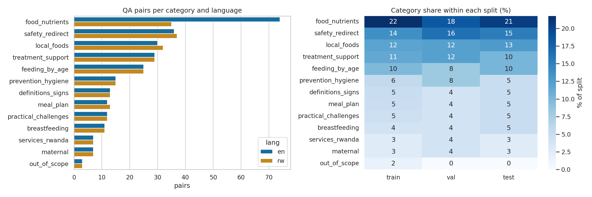
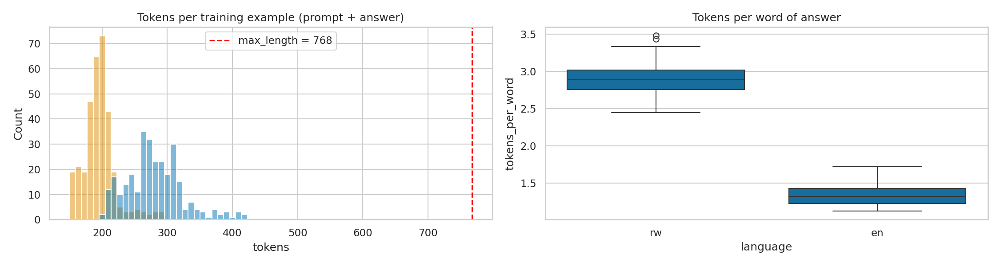
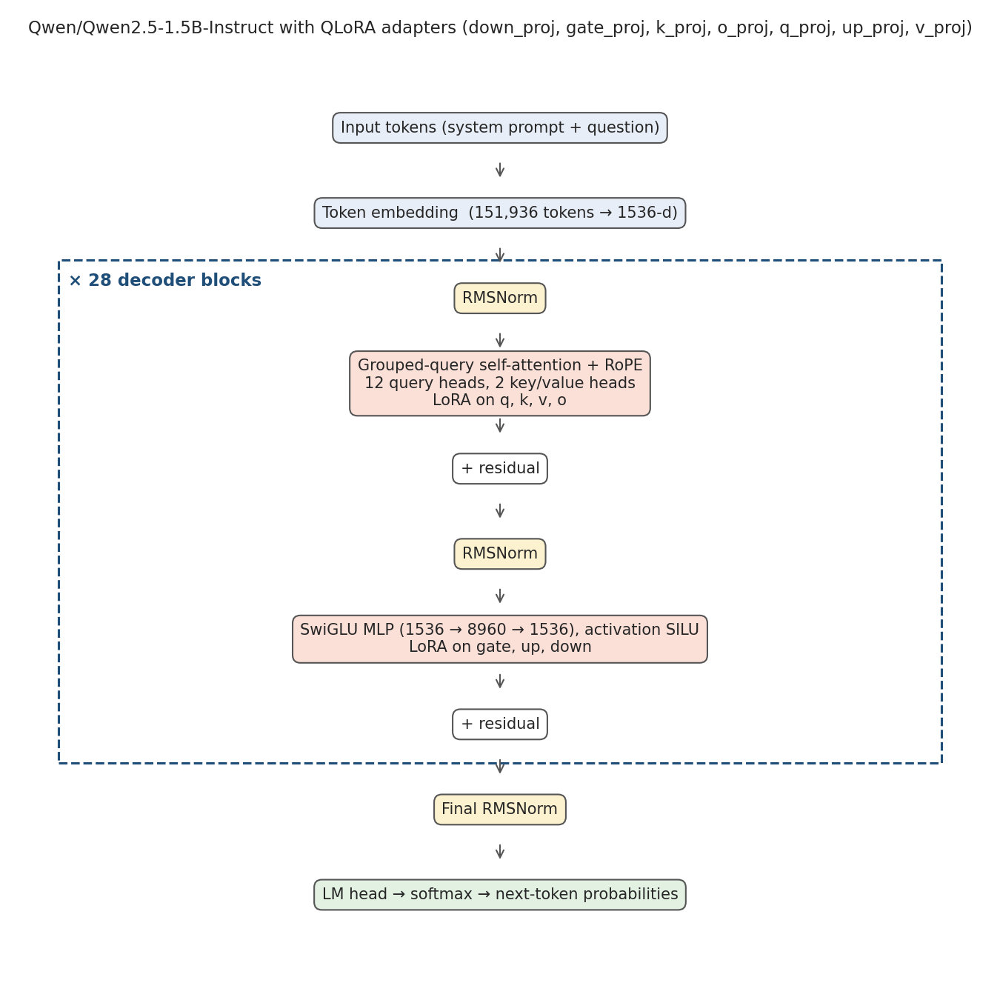
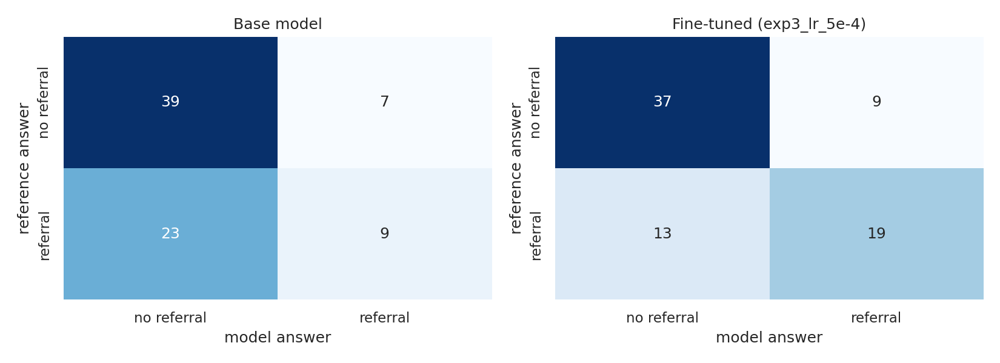

# NutriAssist-RW: technical details

How the system is built, the algorithms it uses, and how it was trained, tested and deployed. Setup and
usage are in the [README](../README.md); the [technical report](https://docs.google.com/document/d/1BxUJMjiChwt-fdrzl4D_yUkv_gVp7zRuUHOEspxrXbw/export?format=pdf)
summarises the same work in five pages.

## Features and where they live

| Feature | What it does | Code |
|---|---|---|
| Chat assistant | Answers in the language of the question. A question that matches a native-speaker-reviewed pair gets that answer word for word; otherwise the fine-tuned model answers (Gemma-3-4B live, Qwen2.5-1.5B locally). AI-written answers carry a label | `src/nutriassist/assistant.py`, `src/nutriassist/knowledge.py` |
| Kinyarwanda | Unmatched Kinyarwanda questions are translated to English with Gemini, answered by the model and translated back, with a "machine-translated" label. If Gemini fails, the app offers the closest reviewed questions instead ([why](kinyarwanda.md)) | `src/nutriassist/translation.py`, `src/nutriassist/terms.py` |
| Safety layer | WHO/IMCI danger signs in English and Kinyarwanda get a fixed referral before any model is called; medicine doses are blocked; a referral is added when a medical answer lacks one; fixed answers for honey and tea for young children | `src/nutriassist/safety/` |
| Scope checks | Questions about adults or children over 5 are declined without the model, unless a young child or a pregnant or breastfeeding mother is also mentioned. An empty model answer gets the same out-of-scope message | `src/nutriassist/safety/subject.py` |
| Growth check | WHO 2006 z-scores (weight-for-height, height-for-age, weight-for-age) and MUAC cut-offs; severe cases are referred, others get feeding advice and a meal plan ([details](screening.md)) | `src/nutriassist/screening/` |
| Meal planner | 1–7 day plans for children aged 6–59 months from 33 local foods, meeting WHO energy targets and minimum dietary diversity, with portions in tablespoons | `src/nutriassist/planner/` |
| CHW sign-in (demo) | Community health workers sign in with a CHW ID and a code; made-up IDs stand in for Ministry of Health records | `app/chw_login.py` |
| REST API | FastAPI with Swagger UI, input validation and clear error messages | `src/nutriassist/api/` |
| Web app | Sign-in, Chat, Growth check, Meal planner and How to use pages in English and Kinyarwanda, with a disclaimer before first use | `app/streamlit_app.py`, `app/views/` |
| Data pipelines | Cleaning of the food composition workbook; the bilingual QA dataset with leak-free splits | `src/nutriassist/food_data/`, `src/nutriassist/qa_data/` |

## Architecture

The same package runs in two deployments.

| | Live | Local (optionally in Docker) |
|---|---|---|
| Frontend | Streamlit on Streamlit Community Cloud | Streamlit |
| Backend | Gradio app on a free Hugging Face ZeroGPU Space, `/chat_json` endpoint (`app/gradio_app.py`) | FastAPI over HTTP, Swagger UI at `/docs` |
| Model | Gemma-3-4B-it + LoRA adapter, Transformers, on a GPU borrowed only while it writes | Qwen2.5-1.5B-Instruct + LoRA, 4-bit GGUF with llama.cpp on the CPU |
| Runs in the frontend | danger signs, scope checks, growth check, meal planner | everything goes through the API |

The live request flow:

```
                Streamlit Community Cloud (app/space_client.py)               Hugging Face ZeroGPU Space
 Browser ─► sign-in ─► chat ─► danger-sign rules ─┬─ urgent ──────► fixed referral message
                                                  ├─ out of scope ► fixed out-of-scope message
                                                  └─ other ── /chat_json ─► reviewed answer?  ── yes ─► reviewed answer
                                                                                │ no
                                                                                ├─ English: Gemma-3-4B + LoRA
                                                                                └─ Kinyarwanda: Gemini → model → Gemini
                                                                                     └► dose check, referral check, topic rules
            growth check ─► WHO z-scores, MUAC ─► referral, or advice + meal plan
            meal planner ─► targets by age (WHO/FAO) ─► greedy food selection ─► portions, coverage, tips
```

Danger signs and out-of-scope questions are answered in the Streamlit app by the same rules the Space
uses, so an urgent answer never waits in the GPU queue and no GPU time is spent on questions the app is
not for (see [load testing](performance.md#load-testing-locust)).

## Object-oriented design

- **Abstraction and inheritance.** `ChatModel` (`src/nutriassist/inference/base.py`) is an abstract base
  class with one abstract method, `generate_batch`. `TransformersChatModel` (GPU, training and evaluation),
  `LlamaCppChatModel` (CPU, local app), `ZeroGPUChatModel` (live app), `ScriptedChatModel` (tests and demo
  mode) and `PipelineChatModel` (evaluation of the full app) inherit from it.
- **Polymorphism.** The assistant, the evaluator and the API call `generate` on any `ChatModel`, so one
  model can replace another without changes to them. Translators follow the same idea with the
  `Translator` protocol: `GeminiTranslator`, `ClaudeTranslator` and `NllbTranslator` are interchangeable,
  and `CachingTranslator` and `FallbackTranslator` wrap any of them.
- **Dependency inversion and open/closed.** `NutritionAssistant` receives its model, translator, knowledge
  base, danger-sign detector, topic rules and relevance checker through its constructor. Tests pass in
  scripted versions, and a new model or translator needs no change to the assistant.
- **Encapsulation.** Classes such as `MealPlanner`, `KnowledgeBase` and `LlamaCppChatModel` keep their
  state private (for example the lock around llama.cpp generation) and expose small public methods.
- **Single responsibility and modularity.** Each module has one job (language detection, safety rules,
  matching, translation, planning, screening, API). Configuration lives in dataclasses (`Settings`,
  `TrainingConfig`, `GenerationSettings`), data in typed classes (`QADataset`, `FoodCatalogue`, `MealPlan`).

## Algorithms and problem solving

- **Danger-sign detection:** compiled bilingual patterns with multi-part rules ("baby under 2 months"
  **and** "fever") and an English negation window ("not vomiting"). Linear in message length; no false
  urgent alarms on the 707 ordinary questions in the dataset.
- **Who the question is about:** a rule-based check of ages ("15-year-old", "imyaka 7") and people
  (grandmother, husband, teenager) in both languages decides whether a question is outside the target
  group, without a model.
- **Reviewed-answer matching:** character TF-IDF similarity with a 0.75 threshold, chosen on the
  validation set. Foods and numbers in the question must also agree with the matched question, because
  "beef" otherwise matched "chicken" at 0.86.
- **Meal planning:** greedy slot filling that scores each food by the nutrients still needed, a bonus for
  a new WHO food group and a penalty for foods eaten in the previous two days; then energy calibration
  and rounding to household measures.
- **Growth check:** WHO 2006 LMS z-scores, with WHO's restricted form beyond ±3 SD for the weight
  indicators, and MUAC cut-offs.
- **Language detection:** function-word and Kinyarwanda noun-class-prefix scoring; correct on all 1,327
  dataset texts.
- **Training:** loss on answer tokens only; QLoRA (4-bit NF4 base model, LoRA on all linear layers); a
  resumable experiment runner.
- **Food data cleaning:** the workbook gives values per serving, not per 100 g, with unit errors and a
  shifted column in 300 rows; the pipeline detects and corrects them ([details](nutrient_cleaning.md)).

## Model and results

The live model is Gemma-3-4B fine-tuned with QLoRA (`exp9_gemma3_4b`), selected from 10 runs by
validation chrF. On the 78 held-out test questions (English and Kinyarwanda), against the same model
before fine-tuning:

| Test metric | Base model | Fine-tuned | Change |
|---|---|---|---|
| ROUGE-L | 6.0 | 31.0 | +417% |
| chrF | 24.0 | 39.7 | +65% |
| BLEU | 0.5 | 14.0 | +13.5 points |
| Perplexity (lower is better) | 189.3 | 7.5 | −96% |
| Referral F1 | 36.0% | 75.4% | +109% |
| Language match | 57.7% | 100% | +73% |
| Numeric accuracy (±10%) | 25.3% | 30.5% | +21% (+5.2 points) |

On reworded test questions the model never saw, scores fell by only 1.4–5.6%. Numeric accuracy is the
proposal's main metric and improved by less than its +20-point target, which is one reason the numbers
that matter most come from code: meal-plan amounts from the planner, danger signs from the rules.

**Hyperparameter experiments** (QLoRA on a Colab A100; validation set). Each run changes one setting from
`exp1_baseline`; exp7–exp10 change the base model.

| Experiment | LR | Rank | Epochs | Time (min) | Peak GPU (GB) | Val perplexity | Val chrF | Val ROUGE-L |
|---|---|---|---|---|---|---|---|---|
| Qwen2.5-1.5B base | – | – | – | – | – | 54.2 | 22.3 | 9.3 |
| exp1 baseline | 2e-4 | 16 | 3 | 5.2 | 17.4 | 11.0 | 32.6 | 26.7 |
| exp2 | 1e-4 | 16 | 3 | 5.2 | 18.3 | 13.0 | 30.0 | 25.6 |
| exp3 | 5e-4 | 16 | 3 | 5.2 | 19.2 | 11.1 | 34.6 | 28.2 |
| exp4 | 2e-4 | 8 | 3 | 5.2 | 20.0 | 11.7 | 31.8 | 26.7 |
| exp5 | 2e-4 | 32 | 3 | 5.3 | 21.2 | 10.8 | 33.6 | 26.2 |
| exp6 | 2e-4 | 16 | 5 | 8.7 | 21.8 | 13.4 | 34.8 | 27.0 |
| exp7 Gemma-3-1B | 2e-4 | 16 | 3 | 6.3 | 33.3 | 13.7 | 31.7 | 27.6 |
| exp8 Gemma-2-2B | 2e-4 | 16 | 3 | 6.1 | 32.0 | 10.5 | 36.0 | 30.2 |
| **exp9 Gemma-3-4B (selected)** | 2e-4 | 16 | 3 | 8.0 | 38.7 | **7.9** | **37.3** | 29.4 |
| exp10 exp8 + Kinyarwanda pre-training | 2e-4 | 16 | 3 | 5.9 | 31.2 | 9.7 | 36.1 | 30.4 |

exp9 had the highest validation chrF and lowest validation loss of all runs, and only 4.5% of its
Kinyarwanda answers looped, against 27.3% for the best Qwen run (exp3). Its validation loss was lowest
after epoch 2 (1.72) and rose to 1.84 after epoch 3, so two epochs would likely be better. The training
logs are published with the adapter on the
[Hugging Face Hub](https://huggingface.co/pauline-ish/NutritionAssistant_RW/tree/main/adapter) (copies in
[results/gemma_exp9/](results/gemma_exp9/)); the Qwen runs are also in [results/experiment_table.csv](results/experiment_table.csv).

| | |
|---|---|
|  |  |
|  |  |

**Safety referrals:** does the caregiver get sent to a health worker when the reviewed reference answer
says they should? Same 78 test questions, 12 of them with danger signs.

| | Danger questions referred | Recall | Precision | F1 |
|---|---|---|---|---|
| Base model | 2/12 | 28.1% | 50.0% | 36.0% |
| Fine-tuned model | 11/12 | 81.2% | 70.3% | 75.4% |
| Full app | 9/12 | 62.5% | 80.0% | 70.2% |

The full app raises fewer false alarms but refers fewer danger questions; the loss is all in Kinyarwanda,
where unmatched questions go through translation and the rules fire only on named signs. Recall is below
the proposal's 90% target.

**Growth check:** with no labelled Rwandan child records, the z-score code was tested against WHO's own
tables: all 61,396 measurements placed 0.01 kg or cm either side of every −3, −2 and +2 SD line were
classified correctly ([details](screening.md)).

## Testing

505 automated tests (`pytest`) run on every push in GitHub Actions on Ubuntu, Windows and macOS with
Python 3.12, and on Ubuntu with Python 3.10.

| Strategy | What is tested | Where |
|---|---|---|
| Unit | metrics, planner rules, safety and scope rules, language detection, matching, translation fallback, data cleaning | `tests/test_planner.py`, `tests/test_safety.py`, `tests/test_subject.py`, … |
| Data validation | no train/test leakage; safety rules and language detector checked against every dataset question | `tests/test_qa_dataset.py`, `tests/test_language.py` |
| Integration | real QLoRA training and generation with a tiny model on the CPU; the HTTP API with validation and error cases; the Streamlit app's Space client | `tests/test_integration_training.py`, `tests/test_api.py`, `tests/test_space_client.py` |
| End-to-end | Streamlit pages driven against a live API server: disclaimer, chat, urgent alert, language switch, 7-day plan; the Gradio app and its model-loading path | `tests/test_frontend.py`, `tests/test_gradio_app.py` |
| Compatibility | the test suite on three operating systems and two Python versions; the live app checked by hand in Chrome and Edge on Windows 11 and on an Android phone | `.github/workflows/tests.yml`, [performance.md](performance.md) |
| Performance and load | model speed by CPU thread count (low-end vs high-end), memory, API and Space timings; Locust load tests before and after each fix | `scripts/benchmark.py`, `scripts/load_test/`, [performance.md](performance.md) |

Improvements made after testing:
- A model answer said honey is safe from 1 month, so honey and tea questions now get fixed answers.
- "My child … won't drink" and "very sleepy" were not caught, so the danger-sign rules were widened.
- Questions about a grandmother or a 15-year-old got model answers on the live app, so the scope check
  was added; an empty model answer now gets the out-of-scope message.
- The load test showed urgent answers waiting behind model answers, so the llama.cpp lock now covers only
  generation, and the live app answers danger signs without the Space (2.2 s → 1 ms).

## Repository structure

```
├── app/                         web interfaces
│   ├── streamlit_app.py         Streamlit app: sign-in, disclaimer, sidebar, navigation
│   ├── views/                   chat, growth check, meal planner and how-to pages
│   ├── space_client.py          live backend: chat on the ZeroGPU Space, the rest in Streamlit
│   ├── api_client.py            HTTP client for the local FastAPI backend
│   ├── chw_login.py             demo CHW sign-in
│   ├── gradio_app.py            the ZeroGPU Space app (/chat_json endpoint)
│   ├── texts.py, i18n.py        English and Kinyarwanda interface text, language selection
├── src/nutriassist/             Python package (installable)
│   ├── assistant.py             chat pipeline: language → safety and scope rules → reviewed answers → model → output checks
│   ├── knowledge.py, terms.py   reviewed-answer matching, "Did you mean...?", bilingual food and health terms
│   ├── translation.py           Gemini, Claude and NLLB translators, caching and fallback
│   ├── safety/                  danger signs, scope, topic rules, referral and relevance checks, messages
│   ├── screening/               WHO growth check
│   ├── planner/                 nutrient targets, food catalogue, meal planner, tips
│   ├── inference/               ChatModel base class and GPU / CPU / scripted models
│   ├── training/, evaluation/   QLoRA fine-tuning and experiment runner; metrics and evaluation pipeline
│   ├── food_data/, qa_data/     food workbook cleaning; QA dataset builder and review sheets
│   ├── api/                     FastAPI app, schemas, settings
│   └── language.py, prompts.py  language detector; system prompt shared by training and the app
├── notebooks/                   Colab training and evaluation notebook
├── data/                        raw and cleaned food tables, QA data, reference data
├── tests/                       505 tests (unit, data validation, integration, end-to-end)
├── docs/                        documentation, results, screenshots
├── deploy/hf-zerogpu/           Hugging Face ZeroGPU Space files
├── scripts/                     local launcher, benchmark, load tests, calibration
└── Dockerfile                   API + app in one container
```

## Training the model

Open the [training notebook in Colab](https://colab.research.google.com/github/pauline12ish34/NutriAssist_Capstone/blob/main/notebooks/nutriassist_training.ipynb)
on a GPU runtime (an A100 or L4 for Gemma; a T4 works but is slower) and run all cells. It installs this
package from GitHub, explores the data, describes the model architecture, scores the base model, runs the
hyperparameter experiments (recording time and GPU memory), evaluates the selected one on the test set
and compares answers side by side. Outputs are saved to `MyDrive/NutriAssist-RW/outputs/`. To rebuild the
datasets:

```bash
python -m nutriassist.food_data.build_foods
python -m nutriassist.qa_data.build_qa_dataset
```

## Deployment

- **Live:** the Streamlit app runs on Streamlit Community Cloud and sends chat to a free Hugging Face
  ZeroGPU Space, protected by a shared secret token. Hugging Face only gives free GPUs to Gradio apps, so
  the Space is a small Gradio app with a JSON endpoint. A passing test run on `main` restarts the Space so
  it uses the latest code.
- **Local:** `python scripts/run_local.py` starts FastAPI and Streamlit, or one Docker container runs both,
  with the model on the CPU.

Step-by-step instructions are in the [deployment guide](deployment.md).

## Documentation

- [Data inspection](data_inspection.md) and [nutrient cleaning](nutrient_cleaning.md)
- [QA dataset design](qa_dataset.md) and [dataset report](../data/QA_data/processed/qa_report.md)
- [Kinyarwanda: reviewed answers and translation](kinyarwanda.md)
- [Growth check](screening.md)
- [Performance, compatibility and load testing](performance.md)
- [Usability test: tasks, SUS form and scoring](usability_test.md)
- [Deployment guide](deployment.md)
